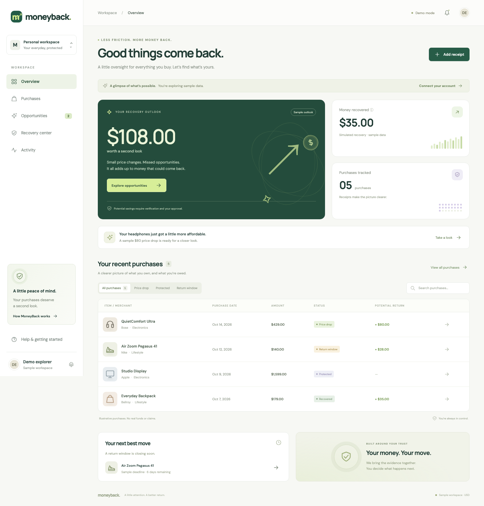

# MoneybackOS

**Find savings hiding in purchases you’ve already made.**

[](https://github.com/JyothiNandhan/SwampHacks2026/actions/workflows/ci.yml)
[](https://github.com/JyothiNandhan/SwampHacks2026/actions/workflows/godaddy-web.yml)

MoneybackOS brings purchases, receipts, price observations, and recovery evidence into one workspace. It helps you spot a price drop, follow up on a missing refund, or catch a purchase deadline—with the evidence and next steps in one place.

Built for **SwampHacks 2026**, with Capital One Nessie sandbox banking, Gemini document extraction, and a responsive web dashboard.

[Quick start](#quick-start) · [How it works](#how-it-works) · [Architecture](#architecture) · [Configuration](#configuration) · [Documentation](#documentation)

<p align="center">
  
</p>

*Dashboard preview with illustrative purchases and sample figures. The financial demonstration uses simulated Nessie deposits; no real merchant refund is initiated.*

## What you can do

| Capability | What it provides |
| --- | --- |
| Purchase memory | Import Nessie sandbox transactions and connect them to receipt evidence. |
| Receipt understanding | Extract merchant, date, total, and item details from photos, PDFs, and email text with Gemini. |
| Receipt matching | Review transaction matches and group duplicate paper/email evidence while retaining originals. |
| Price monitoring | Collect SerpApi and Bright Data observations and evaluate product identity, condition, stock, shipping, and freshness. |
| Recovery cases | Gather evidence, review recommendations, and record explicit user approval. |
| Refund reconciliation | Match correlated, completed simulated deposits to refund expectations without counting an allocation twice. |
| Purchase protection | Evaluate return/warranty terms, subscription changes, rental billing differences, and supported deadlines. |
| Account access | Use provisioned per-user tokens or configure Auth0 login. Gmail receipt importing is an optional, user-triggered connection. |

### Current status

The API and worker are deployed on Railway. The Next.js dashboard is implemented, and the repository exports an independent frontend for GoDaddy.

Recorded verification includes Nessie sandbox purchase imports, Gemini extraction of synthetic receipts, private evidence persistence after redeployment, and a separate **$10 simulated refund reconciliation** using a controlled billing fixture. The complete retail-to-simulated-refund workflow also has an offline fixture-based integration test.

**Still being completed:** live OAuth/Gmail activation and consent checks, the full live retail-to-refund positive path, dashboard case/notification history, pagination controls, and background Gmail monitoring. The browser extension is a planning scaffold. See the [release verification record](docs/release/VERIFICATION.md) and [frontend verification notes](docs/frontend/VERIFICATION.md) for the scope of each check.

## How it works

```text
Nessie sandbox purchase + receipt
                ↓
Extract details and match the purchase
                ↓
Collect product offers and policy evidence
                ↓
Review an opportunity and approve a recovery case
                ↓
Record an authorized simulated submission
                ↓
Reconcile a specifically correlated Nessie deposit
```

Gemini interprets documents. Application code validates the output, calculates monetary amounts in integer cents, and applies the recovery rules. Uncertain matches and incomplete eligibility evidence stay available for review.

A lower advertised price alone does not establish savings. Refund confirmation requires supporting account/reference/date/amount evidence; an equal-value deposit alone is insufficient. Case approval does not automatically submit a merchant request.

## Quick start

### 1. Install the pinned toolchain

Use **Node.js 22.16.0** and **pnpm 9.15.9**, as declared in `.nvmrc` and `package.json`.

```bash
git clone https://github.com/JyothiNandhan/SwampHacks2026.git
cd SwampHacks2026

# If you use nvm:
nvm install
nvm use

npm install --global pnpm@9.15.9
pnpm install --frozen-lockfile
```

Dependency versions are managed in [the workspace catalog](pnpm-workspace.yaml) and [version configuration](config/technology-versions.json). The root `pnpm-lock.yaml` locks the workspace installation; `deployment/godaddy/package-lock.json` is the separate lockfile used by the generated standalone GoDaddy frontend.

### 2. Explore the dashboard

```bash
pnpm --filter @moneyback/web dev
```

Open **http://localhost:3000**. You can explore the labeled demo without connecting a bank account or supplying provider credentials. Demo prices, savings, and recoveries are illustrative.

To configure account access or point the dashboard at your local API:

```bash
cp apps/web/.env.example apps/web/.env.local
```

Set `API_BASE_URL=http://localhost:3001` in that file for a local backend. Next.js loads the frontend’s local environment file. Auth0 login requires the additional settings described in the [OAuth guide](docs/frontend/AUTH0_GMAIL.md).

### 3. Run the API

For a health-only development server with no configured integrations:

```bash
pnpm dev:api
curl http://localhost:3001/health
```

Expected response:

```json
{"status":"ok","service":"moneyback-api"}
```

For a configured backend, copy `.env.example` to `.env` and fill in your own settings. Use a private, writable local `EVIDENCE_DIRECTORY`; the example `/data/evidence` path is intended for a mounted deployment volume.

```bash
cp .env.example .env
# Edit .env privately before continuing.
pnpm build

# Apply migrations to the DATABASE_URL configured in .env.
node --env-file=.env --import tsx packages/db/src/cli.ts

# Start the compiled API with that environment.
node --env-file=.env apps/api/dist/server.js
```

The API and worker read their process environment; simply creating `.env` does not load it into `pnpm dev:api` or `pnpm dev:worker`. Use the explicit `--env-file` launch above, or export the required variables before using the development commands. See [database setup](packages/db/README.md) for migrations and provider TLS requirements.

### 4. Run the worker when configured

In another terminal, after building and configuring the database and internal API credentials:

```bash
node --env-file=.env apps/worker/dist/service.js
```

The worker needs `DATABASE_URL`, `INTERNAL_API_URL`, and `INTERNAL_WORKER_TOKEN`. The same internal token must be configured on the API. Scheduled price monitoring remains disabled until `WORKER_SCHEDULE_ENABLED=true` and purchase-specific monitoring consent is recorded. See [the worker guide](apps/worker/README.md).

## Configuration

Start with [.env.example](.env.example). Add only the integrations you intend to enable.

| Component | Required settings for the feature |
| --- | --- |
| Database and API | `DATABASE_URL`; `NESSIE_API_KEY` is also required for production startup. |
| Protected API access | `API_TOKENS_JSON` for provisioned users, or `AUTH0_ISSUER` + `AUTH0_AUDIENCE`; production also requires `INTERNAL_WORKER_TOKEN`. |
| Private receipt storage | `EVIDENCE_DIRECTORY` pointing to persistent, writable storage. |
| Gemini extraction | `GEMINI_API_KEY`, `GEMINI_MODEL`. |
| Retail observations | `SERPAPI_API_KEY`, `BRIGHTDATA_API_KEY`, and the enabled retailers’ dataset IDs. |
| Frontend API proxy | `API_BASE_URL` containing the API origin. |
| Auth0 frontend | `APP_BASE_URL`, `AUTH0_DOMAIN`, `AUTH0_CLIENT_ID`, `AUTH0_CLIENT_SECRET`, `AUTH0_SECRET`, `AUTH0_AUDIENCE`. |
| Gmail import on the API | `GOOGLE_CLIENT_ID`, `GOOGLE_CLIENT_SECRET`, `GMAIL_REDIRECT_URI`, `EMAIL_TOKEN_ENCRYPTION_KEY`, plus document extraction/storage configuration. |

`APP_BASE_URL` must be an exact frontend origin without a path, query, or share token. Register `<APP_BASE_URL>/auth/callback` with Auth0 and `<APP_BASE_URL>/api/email/callback` with Google. Verify that the deployed callback routes are accessible; access to a token-protected preview link alone does not establish that.

Keep provider secrets, database URLs, account tokens, `.env`, and `.env.verify` out of Git. Provider secrets belong in the appropriate hosting service’s secret settings and must not use a `NEXT_PUBLIC_` prefix. Local file changes do not update hosted variables.

## Architecture

```text
Next.js dashboard · GoDaddy
             │
             │ Same-origin server proxy
             ▼
Fastify API · Railway ─────────── Gemini / Nessie / retail providers
             │
             ├── Tiger Data / PostgreSQL
             ├── Private persistent receipt evidence
             └── Internal authenticated job endpoint
                              ▲
                       Railway worker
```

| Layer | Technology |
| --- | --- |
| Web dashboard | Next.js, React, TypeScript, Auth0 SDK |
| API | Fastify, Zod, JOSE |
| Storage | Tiger Data/PostgreSQL, private evidence volume |
| Document extraction | Google Gemini through `@google/genai` |
| Banking simulation | Capital One Nessie |
| Retail evidence | SerpApi, Bright Data |
| Verification | Vitest, PGlite, PostgreSQL integration checks, GitHub Actions |
| Deployment | Railway API/worker, GoDaddy frontend, Docker |

### Repository map

```text
apps/
  api/          API, integrations, provider adapters, recovery services
  web/          Next.js dashboard and server-side proxy
  worker/       Durable jobs and consent-based price scheduling
  deepspace/    Separate real-time notification foundation
  extension/    Planned browser extension scaffold
packages/
  contracts/    Shared runtime schemas, types, and JSON fixtures
  db/           PostgreSQL migrations and migration runner
config/         Route, environment, naming, and version contracts
docs/
  frontend/     Hosting, OAuth activation, and frontend verification
  release/      Demo runbook, API specification, and verification records
scripts/        Setup, export, and release utilities
```

The DeepSpace app is a separate foundation for user-scoped notification experiments. The Railway API and Tiger Data remain the financial source of truth. See [its setup notes](apps/deepspace/README.md) before enabling it.

## Development and verification

```bash
# Version/contract checks, workspace types and tests, backend builds
pnpm check

# API release integration tests
pnpm --filter @moneyback/api test:release

# Synthetic receipt, duplicate, and policy regression evaluation
pnpm --filter @moneyback/api evaluate:receipts

# Frontend production build (separate from the root backend build)
pnpm --filter @moneyback/web build
```

Tests can run without live provider credentials. Optional PostgreSQL-driver tests use `TEST_DATABASE_URL` for a disposable database. CI additionally runs migrations and integration checks against PostgreSQL 16.10.

The recorded synthetic receipt/duplicate/policy evaluation passed **15/15 expectations**. This describes a regression suite, not measured accuracy on real-world receipt photos. Live verification is a separate, explicitly configured operation; consult the [demo runbook](docs/release/DEMO.md) before running scripts that access providers or create sandbox records.

## Deployment

- **API and worker:** Railway services track `main`, build from the repository root, and use the service configuration under `apps/api` and `apps/worker`. The API needs persistent evidence storage and database migrations. Follow the [backend deployment handoff](docs/release/HANDOFF.md).
- **Frontend:** the **Sync GoDaddy frontend** workflow exports and builds `apps/web`, then updates the generated `godaddy-web` branch. Connect GoDaddy to that branch; continue editing source on `main`. The generated branch is replaced by the next export. Follow the [GoDaddy guide](docs/frontend/GODADDY.md).
- **OAuth and secrets:** configure each hosted service separately, then redeploy and verify login, callback access, Gmail consent/import, and disconnect. Follow the [Auth0 and Gmail guide](docs/frontend/AUTH0_GMAIL.md).

The GoDaddy exporter checks its standalone lockfile against the workspace catalog. After changing frontend dependencies, regenerate `deployment/godaddy/package-lock.json` using the procedure in the GoDaddy guide before exporting again. A passing source export does not by itself verify GoDaddy publishing, public access, or live OAuth consent.

## Documentation

| Guide | Use it for |
| --- | --- |
| [Auth0 and Gmail](docs/frontend/AUTH0_GMAIL.md) | Login, consent, callback URLs, hosted variables, and activation checks |
| [GoDaddy deployment](docs/frontend/GODADDY.md) | Standalone frontend export and hosting integration |
| [Database](packages/db/README.md) | Migration behavior, schema, TLS, and database checks |
| [Shared contracts](packages/contracts/README.md) | Canonical JSON shapes and runtime validation |
| [Backend handoff](docs/release/HANDOFF.md) | Service configuration, auth, operator setup, and integration details |
| [Demo runbook](docs/release/DEMO.md) | Reproducible demonstrations and their verification scope |
| [Release verification](docs/release/VERIFICATION.md) | Recorded live results and remaining release work |
| [OpenAPI](docs/release/openapi.json) / [Postman collection](docs/release/MoneyBack.postman_collection.json) | API exploration and authenticated requests |
| [Task tracker](TASK_TRACKER.csv) | Implementation milestones and ownership |

## Roadmap

- Complete live Auth0/Gmail activation and the final retail-to-simulated-refund demonstration.
- Add dashboard case/notification history and pagination controls.
- Introduce opt-in background Gmail monitoring.
- Expand real receipt evaluation and retailer coverage.
- Build user-approved browser capture and evaluate a mobile companion.

MoneybackOS keeps original evidence, requires user approval for recovery actions, and distinguishes potential savings from confirmed simulated outcomes.
